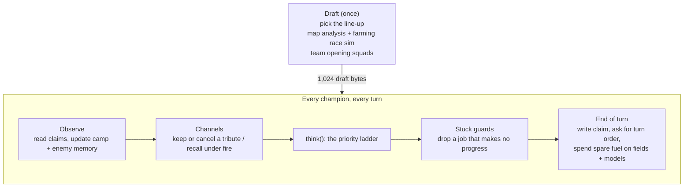

# How the bot works: the high-level idea

This is the big picture of v294, the final submission of team **conqueror_of_openai**.
Each engine gets its own detailed doc later; this page explains how the parts fit together and why they are shaped
the way they are.

## The game in one paragraph

Two teams draft up to five champions each, then play up to 2,000 rounds on a grid map. Gems are the score. Camps of
neutral monsters sit around the map. A team clears a camp, stands on it to capture the reward (gold and gems), carries
the gems to an altar and tributes them. Only tributed gems count, and a champion that dies drops what it carries. Gold
buys items at the spawn. The first team to tribute 1,000 gems wins; otherwise the most tributed gems at round 2,000 wins.

## The constraints that shaped everything

| Constraint | What it forced |
| --- | --- |
| **Fuel.** Each turn has a fixed instruction budget (about 100k fuel), and a turn that runs out finishes next round on stale data. | Every decision is a closed-form price or a small cached search. Expensive work (distance fields, model set-up) runs from *spare* fuel at the end of a turn. |
| **No shared vision.** A champion sees only its own view and its own ward. | Each champion keeps its own memory of camps and enemies, and every model is trained on what the bot could actually see. |
| **8 bytes of team memory** for the whole match. | One *claim byte* per champion: which camp it is working on, whether it is capturing, whether it is retreating. That is all the live coordination there is. |
| **The draft** sees the whole map, gets about 100× a normal turn's fuel on its first call, and can leave 1,024 bytes for the champions. | The only moment the team can plan together. The draft analyses the map once and writes a plan that every champion reads. |
| **One program.** The draft bot and every champion run the same code, each as its own instance. | Nothing is sent between champions except the claim bytes, so a team plan has to be *common knowledge*: everyone computes or reads the same thing. |

## The core idea: one currency, one decision per question

Every champion is an independent decision maker. On each turn it asks "what is the best thing I can do right now?",
and every option is priced in the same unit: **banked gems per round**. Gold, kills, deaths, carried gems and the
risk of getting caught are all converted into that unit, so a camp job, an altar trip, a shopping trip and a fight can
be compared directly.

Each question gets one calculator, and the rest of the code asks that calculator instead of keeping its own estimate:

- **How long does this camp take, and does it hurt?** → the camp engine
- **Which camp should I work next?** → the job engine
- **Is my bag big enough to walk it to the altar?** → the bank engine
- **Fight, flee or hold against enemy champions?** → the fight turn and the micro search
- **Is the item worth the walk home?** → the shop

Coordination comes from three places, none of which needs messages: claims (I am on this camp), plans written in the
draft (everyone knows the opening), and shared rules (everyone runs the same choice on the same facts, so they agree).

## The flow of a match



### 1. The draft

- **Line-up.** One fixed line-up on every map: Vesper Vale, Marcella, Heart of Ruin, Vendetta, Ryth (a smaller team
  takes the first picks).
- **Map plan.** For every camp group: walking distance from our spawn, from the enemy spawn and to an altar, and which
  side of the map it is on.
- **Farming race.** A pre-simulation of the first 200 rounds, with our line-up farming the way our champions really
  farm and a mirror team at the enemy spawn. It marks where and when we would meet enemy bodies.
- **Team opening.** The bodies are split into squads, and each squad gets the camp route that earns most in the opening.
  Because every champion reads the same bytes, the squads form without a message.

### 2. A turn: the priority ladder

`think()` walks a fixed order and stops at the first rule that uses the turn:

1. **Enemy champions in reach** → the fight turn (kill, finish, flee, battle, or shoot from safe ground).
2. **Low health** → go home to heal.
3. **Capture in progress** → hold the camp until it pays.
4. **Hold a flight or chase.**
5. **Bank** → walk the bag to the altar and tribute it.
6. **Break an enemy capture** that we can reach in time.
7. **Shop trip** → go home when the item is worth the time away.
8. **Team objectives** → rallies, shared captures, the respawn appointment at rich contested camps.
9. **Otherwise: the job** → walk to the chosen camp and clear it.

After `think()`, a set of **stuck guards** watches for ways of getting nowhere (walking without getting closer, hitting
a camp whose health does not move, a capture that never pays, two allies blocking a corridor). Each guard gives the job
up for a while so the planner chooses again.

### 3. The engines

| Engine | What it decides | Idea |
| --- | --- | --- |
| **Job engine** (`brain/brain_jobs.h`, `brain_job_score.h`) | Which camp each champion works next | Value per round of each camp: reward, clear time, travel, chance we keep it versus the enemy taking it, chance of getting caught on the way. |
| **Camp engine** (`camps/camp_calc.h`) | Time to clear a camp and the damage taken doing it | One closed-form calculator from the game rules, checked against replays. Also decides when enough bodies are present to commit to a Monolith. |
| **Bank engine** (`brain/bank_engine.h`, `banking.h`, `lfield.h`) | When the bag is worth an altar trip | A learned risk curve for a bag carried away from banking, updated live from the kills and deaths of this game, plus exact travel-time fields (walk, dash, teleport crystal). |
| **Fight and micro** (`brain/brain_fight_turn.h`, `micro/`) | Fight, flee, chase; which tile and which action this turn | A fight balance of both sides' damage and health picks the mode; a search over every legal plan for this turn scores the kill value against the damage expected on the end tile before our next turn. |
| **Shop** (`brain/shop.h`, `brain_economy.h`) | Item build and when to go home to buy | A trip is worth it when the stat gain over the rest of the game beats the time away. The first emblem is chosen from the camps this map gives us. |
| **Team layers** (`draft/opening.h`, `brain/squad.h`, `mid_plan.h`, `coop.h`, `team_counter.h`) | Squads, contested camps, who joins whom | Opening squads from the draft; a respawn appointment that gathers bodies at rich contested camps through the claim bytes; a share rule that prices what one more body adds to a camp. |

### 4. The learned parts

The hand-written engines provide the structure, and models fitted on recorded ladder games fill in the numbers the
rules cannot give:

| Model | Used for |
| --- | --- |
| Job model (`models/jm*.h`) | Chance of getting caught on the way to a job and at it; chance our team or theirs takes a camp's next capture |
| Win model (`models/wmodel*.h`, `brain/gold_weight.h`) | The exchange rate between gold, carried gems, deaths and kills and banked gems, by round and game state |
| Fight choice (`models/qmodel.h`, `qweights.h`) | Ranks the options of a fight turn, only among the moves strong teams actually make |
| Fight/flee veto (`models/fightmodel2.h`, `flog.h`) | Overrides the hand rule's fight-or-flee call when the model is clearly on the other side |
| Bank risk (inside `brain/bank_engine.h`) | Chance a carried bag dies before it is banked |

Every model is trained only on what the champion itself could see at that moment, because vision is not shared.

## Principles we kept to

- **Model the rules exactly.** Damage, timers and travel are computed from the rules and checked against replays.
  Most bugs were wrong beliefs about the game, not bad tuning.
- **One price per question.** A new strategy gets its own step in the decision, never a switch that turns a part off.
- **Fuel is a budget.** Decisions run first; everything that can wait runs from spare fuel at the end of the turn.
- **Judge on paired games.** The engine is deterministic, so a change is judged on the same maps and seeds as its base
  and by kills, gems and gold, not by a handful of wins.

## Source map

```
bots/v294/src/
  main.cpp      turn loop: set-up, channels, think(), stuck guards, spare-fuel work
  config.h      every tuned value, by topic
  common.h      grid, bitboards, distance fields
  draft/        line-up, map plan, farming race sim, team opening
  game/         map and camp model, champions' stats, navigation, turn order
  brain/        the decision layer: jobs, banking, shopping, safety, objectives, team layers
  camps/        camp engine, Monolith and siege rules, camp combat
  micro/        per-turn fight search against enemy champions
  models/       learned models (generated coefficient files plus their feature code)
```
